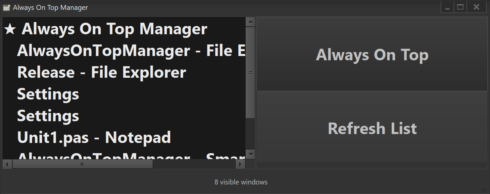

# AlwaysOnTopManager

A lightweight Windows utility for managing which windows stay always on top of others.

## Description

AlwaysOnTopManager provides a simple interface to view all visible windows on your system and toggle their "always on top" state with a single click. Perfect for keeping important applications visible while multitasking.

## Features

- **View all visible windows** - See a complete list of all currently visible windows
- **Toggle always-on-top status** - Click to set or remove the topmost flag for any window
- **Visual indicators** - Windows with topmost status are marked with a ★ star
- **Live refresh** - Update the window list on demand
- **Window details** - View selected window's handle and full title in the status bar
- **Horizontal scrolling** - Support for long window titles
- **Lightweight** - Minimal system resources usage

## Screenshots


*Add your screenshot here*

## Requirements

- Windows 7 or later
- No additional dependencies required

## Installation

### Download Pre-built Binary
Download the latest release from the [Releases](../../releases) page.

### Building from Source

**Requirements:**
- Embarcadero Delphi (tested with Delphi 11)
- VCL Framework

**Steps:**
1. Clone the repository:
   ```bash
   git clone https://github.com/yourusername/AlwaysOnTopManager.git
   ```

2. Open `AlwaysOnTopManager.dproj` in Delphi

3. Build the project:
   - Press `F9` to compile and run
   - Or select `Project > Build AlwaysOnTopManager`

4. The executable will be in the `Win32\Release` folder

## Usage

1. **Launch** AlwaysOnTopManager.exe
2. **Browse** the list of all visible windows - windows marked with ★ are already set to always-on-top
3. **Select** a window from the list
4. **Click** the "Always On Top" button to toggle the topmost state
5. **Refresh** the list anytime to update the window inventory

The status bar shows the selected window's handle and title for reference.

## Contributing

Contributions are welcome! Please feel free to submit a Pull Request.

## License

This project is licensed under the MIT License - see the [LICENSE](LICENSE) file for details.

## Author

Created by Greg Timmons

## Acknowledgments

Built with Embarcadero Delphi

---

If you find this tool helpful, please consider giving it a star ⭐